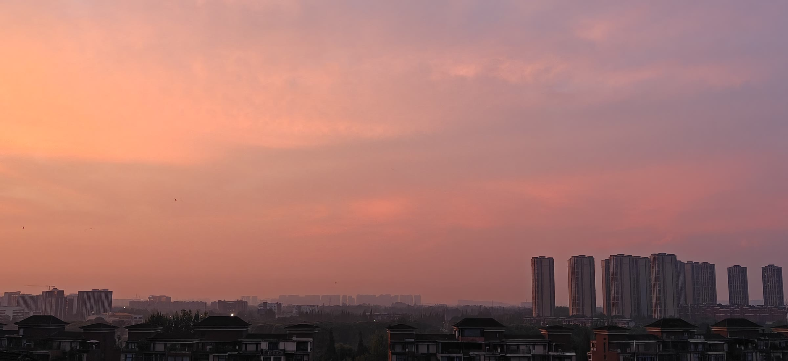
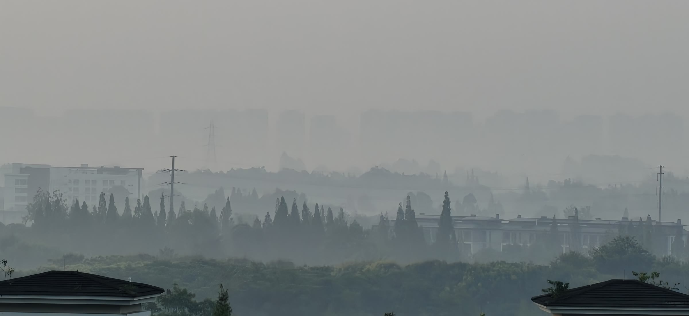
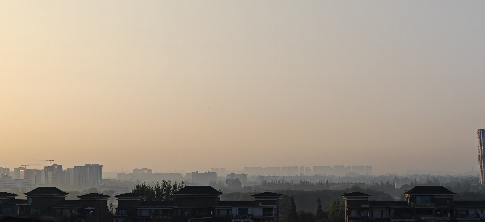
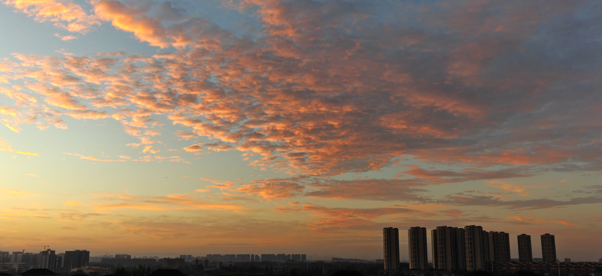
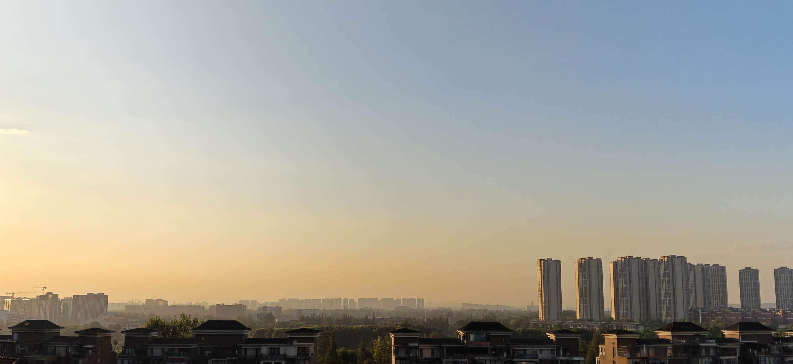
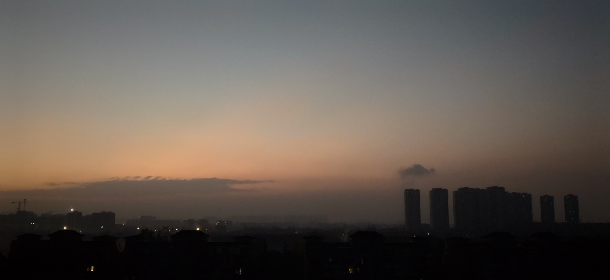
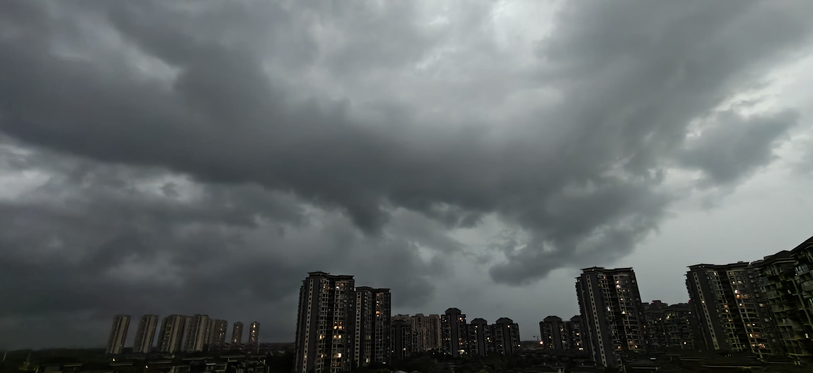
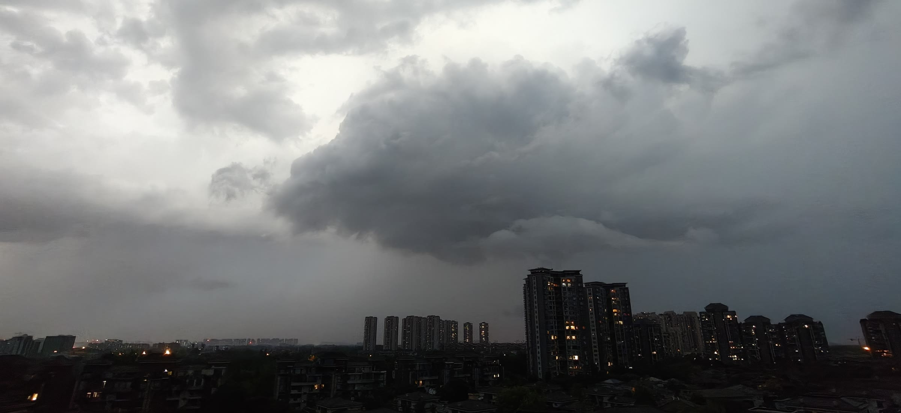
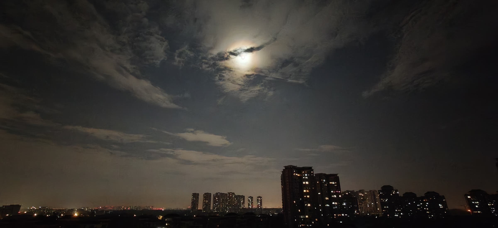
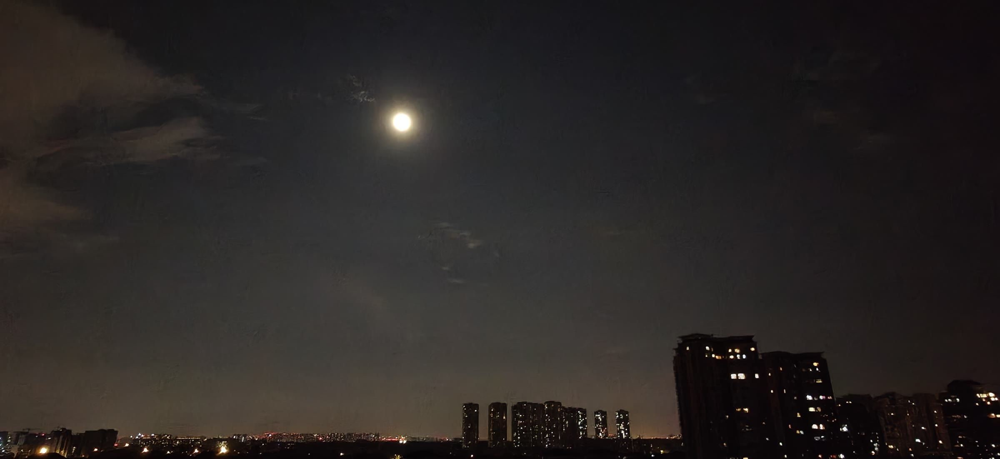

# 寸阑 · 朝昏录

> 寸阑尽揽朝昏色，一境涵收旦暮光

> 一方阳台，十次天光。从清晨的霞、雾、机影，到暮色、雨云与月夜，把 2026 年夏末的朝昏收进一页长卷。
---
### 霞染天际

> 漫天霞光漫开，把整片天空晕成柔和粉橘，平凡的城市轮廓，被暮色揉得浪漫
---
### 淡墨晨雾

> 晨雾漫过林梢与屋顶，楼宇消融在白雾之间，清晨的城，像一幅淡墨山水。
---
### 浅金机影

> 薄雾托着浅金晨光，远处楼群淡成朦胧虚影，一架飞机轻轻划破安静的天光。
---
### 鳞云灼天

> 碎云铺满天际，霞光把鳞云烘成热烈橙红，推开阳台门，恰逢一场盛大云天。
---
### 晨光苏醒

> 暖金天光自地平线慢慢漾开，天色清透柔和，整座城市在晨光里慢慢苏醒。
---
### 暮色沉降

> 暮色缓缓沉降，一层温软橘色铺在天际，远处楼宇静静伫立，在阳台目送白昼落幕。
---
>                      晴光收尽，云色渐起。
>             最耐看的，永远是天将变未变的那一刻。
---
### 云压城来

> 乌云翻涌堆叠，沉沉压向城市上空。风穿过楼宇，一场雨正在赶来。
---
### 雨帘初垂

> 浓云垂落，远方扯开朦胧雨帘，城市半隐进水雾，安静等候风雨降临。
---
### 月晕流云

> 圆月裹着淡淡的月晕，流云缓缓游走，楼下灯火点点，是阳台接住的温柔夜色。
---
### 孤月万家

> 孤月悬于静夜，夜色清简沉静，万家灯火散落在连片楼宇之间。
---
>                           光从不预约，
>               它只在推门的一瞬，与看见它的人相遇。

